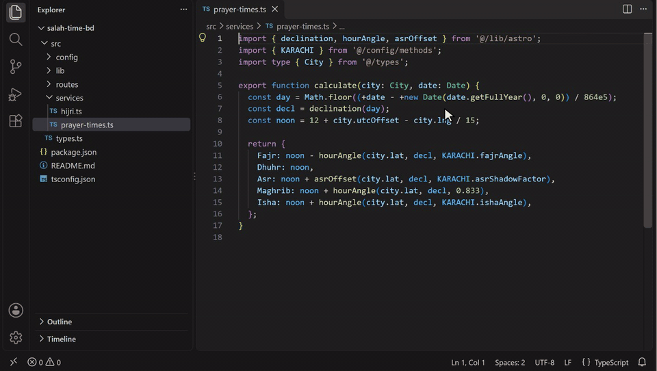

# Import Context Copy

[](https://marketplace.visualstudio.com/items?itemName=evanshareef.import-context-copy)
[](https://marketplace.visualstudio.com/items?itemName=evanshareef.import-context-copy)
[](LICENSE)

Pasting one file into ChatGPT, Claude or Gemini is rarely enough: the model also needs the types, helpers and config that code depends on. **Import Context Copy** collects exactly that and puts it on your clipboard as one prompt-ready block, so you can paste it and ask your question.

It has three commands:

| Command | Where | What you get |
|---|---|---|
| **Copy with Imports as LLM Context** | Right-click a file (Explorer, editor, tab) | The file plus every local file it imports |
| **Copy with Imports as LLM Context (Choose Files...)** | Right-click a file in the Explorer | The same, but you untick files before copying |
| **Copy Block with Dependencies as LLM Context** | Right-click inside a function, or on selected lines | Only that block plus the functions, types and constants it uses |

All three are also in the Command Palette under `LLM Context:`. The status bar shows what was copied and a rough token count.

## Copy a file with its imports


Right-click a file (or several) and choose **Copy with Imports as LLM Context**. The extension follows the file's local imports, breadth-first so the closest dependencies come first, and copies every file it finds. Unsaved changes in open editors are included.

| Language | Followed | Skipped |
|---|---|---|
| JavaScript / TypeScript | `import`, `export … from`, side-effect imports, `import()`, `require()`; `index.*` files; `./x.js` → `x.ts`; `tsconfig`/`jsconfig` path aliases such as `@/…`, including via `extends` and `references` | Packages (`react`, `express`), anything in `node_modules` |
| Python | `import a.b`, `from a import b`, relative `from ..x import y`, `from pkg import submodule`, the `src/` layout | The standard library and installed packages |

Import cycles are handled, and each file is copied once.

## Choose which files to include


**Copy with Imports as LLM Context (Choose Files...)** shows every file it found, with its import depth and token estimate, all ticked. Untick what isn't relevant and press OK.

## Copy just a function and what it uses



Whole files are often more than you need. Right-click **inside a function, method, class or interface** in the editor, or **select some lines**, and choose **Copy Block with Dependencies as LLM Context**. You get that block plus only the definitions it actually uses, followed recursively:

```python
def calculate(a, b):          # right-click here
    total = add(a, b)         # -> copies add()
    diff = sub(a, b)          # -> copies sub(), and scale(), which sub() calls
    return total * diff
                              # other functions in the same files are left out
```

| The block uses… | What gets copied |
|---|---|
| a function or method | just that function or method (methods are labelled `Class.method`) |
| an interface, type alias or enum, or one of its fields | the whole interface, type alias or enum |
| a method called through an interface, e.g. `rule.apply(m)` | the interface **and** the classes' implementations of that method (up to 3) |
| a top-level constant or object | that declaration |
| local variables, parameters, `node_modules`, `site-packages`, the standard library | nothing |

Comments, doc comments and decorators directly above a copied definition are included, because they often explain it. Each block is labelled with its file, line range and name:

````markdown
## src/rules.ts:4-6 · ZakatRule.apply

```ts
  apply(m: Money): Money {
    return { ...m, amount: m.amount * 0.975 };
  }
```
````

This command asks VS Code's language servers where each name is defined, the same information **Go to Definition** uses. So it works with TypeScript and JavaScript out of the box, and with Python, Go, Java, C#, Rust and other languages once their language extension is installed (for Python, the Python extension with Pylance).

## Output format

By default each file or block is a heading followed by a fenced code block, as shown above. Set `llmContextCopy.format` to `xml` to get tagged blocks instead, which work well with Claude:

```xml
<file path="src/routes/today.ts">
…
</file>
<snippet path="src/lib/astro.ts" lines="10-14" symbol="hourAngle">
…
</snippet>
```

## Settings

| Setting | Default | Used by | Description |
|---|---|---|---|
| `llmContextCopy.maxDepth` | `2` | Copy with Imports | Levels of imports to follow (`0` = only the selected files) |
| `llmContextCopy.maxFiles` | `30` | Copy with Imports | Maximum number of files included |
| `llmContextCopy.blockDepth` | `3` | Copy Block | Levels of dependencies to follow |
| `llmContextCopy.maxSnippets` | `40` | Copy Block | Maximum number of code blocks included |
| `llmContextCopy.includeImplementations` | `true` | Copy Block | Include implementations of interface methods that the block calls |
| `llmContextCopy.format` | `markdown` | All | `markdown` or `xml` |

## Privacy

Everything happens locally. The extension reads your files, writes to your clipboard, and sends nothing anywhere. It has no telemetry and makes no network requests. What you paste into an AI tool is up to you.

## Limitations

**Copy with Imports**
- Only JavaScript, TypeScript and Python imports are followed. Files in other languages are copied on their own.
- Imports are found by pattern matching, not a full parser, so unusual syntax (imports built from variables, `importlib`, conditional `require` with computed paths) isn't followed.
- Packages from other folders of a monorepo (`@myorg/shared` from another workspace package) aren't followed.
- Python imports are resolved from the workspace root, the importing file's folder and `src/`; custom `sys.path` setups aren't read.
- An import without an extension (`./config`) only resolves to JS/TS files, so `config.json` isn't found that way. An import that names the file (`./styles.css`, `./data.json`) is copied as-is, imports inside it aren't followed.

**Copy Block with Dependencies**
- It depends on a language server. Without one for that language, only the block itself is copied, and a message says so.
- Right after opening a project the language server may still be starting, and the first copy can include only the block. Wait a few seconds and run it again.
- Import statements aren't copied, only the definitions.
- If a selection uses a variable defined earlier in the same function, that variable's line isn't copied (the enclosing function is never pulled in).
- In Python, `self.x` brings in the method that sets it (usually `__init__`), not the whole class.
- Implementations are added only for interface methods that are called, at most 3 per call. Implementations of Python `Protocol` or abstract base classes depend on what Pylance reports and haven't been tested.
- Names are looked up once per name (plus once at a call site), so two different things with the same name in one block, such as `a.total` and `b.total`, may only resolve one of them.
- Large blocks with many names can take a few seconds, since each name is looked up through the language server.

**Both**
- Only files on disk are supported. Untitled editors and virtual file systems are ignored, and Remote SSH, WSL and Codespaces haven't been tested.
- The token count is an estimate (about 4 characters per token), not an exact count for any specific model.

## Contributing

Issues and pull requests are welcome at [github.com/Evan-CSE/llm-context-copy](https://github.com/Evan-CSE/llm-context-copy/issues).

```sh
npm install
npm test          # compiles and runs the unit tests
```

Press <kbd>F5</kbd> in VS Code to launch an Extension Development Host with the extension loaded. Run `npm run package` to build a `.vsix`.

## License

[MIT](LICENSE)
