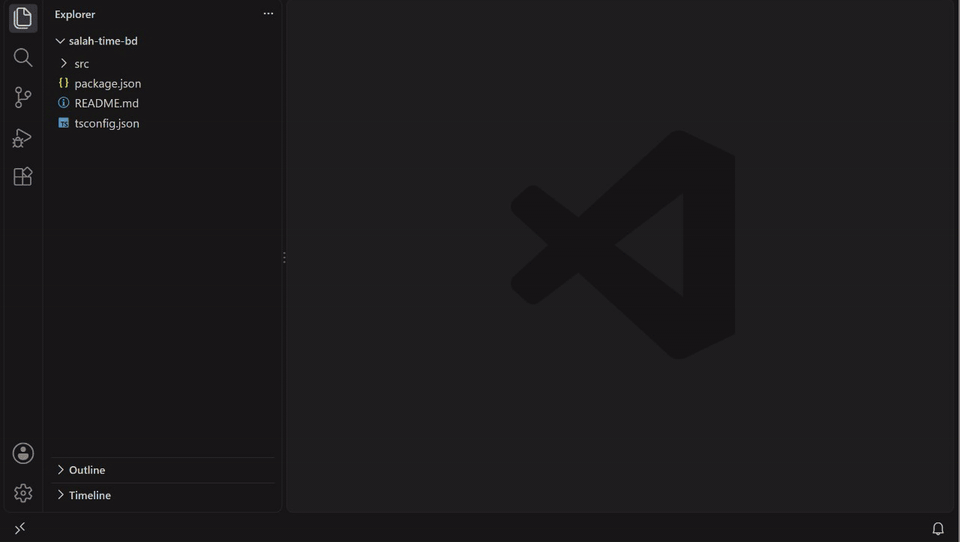
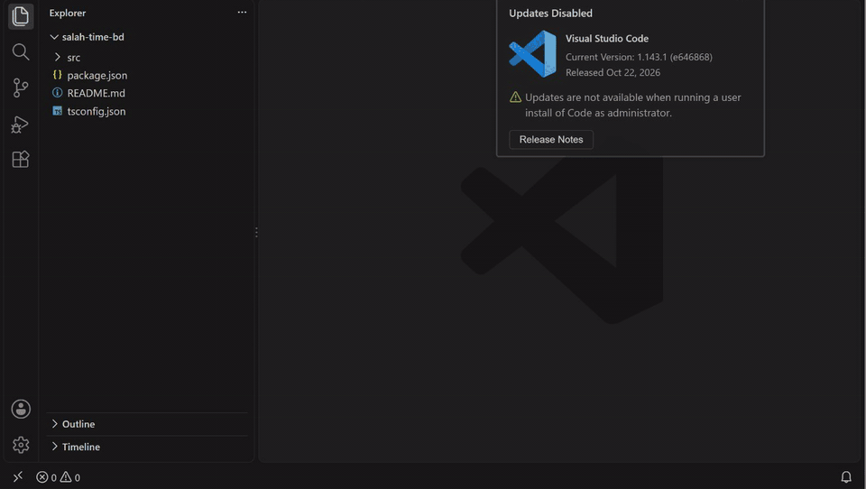

# Import Context Copy

Pasting one file into ChatGPT, Claude or Gemini usually isn't enough, because the model also needs the types, helpers and config that file imports. **Import Context Copy** gathers the file plus the local files it imports and puts them all on your clipboard as one prompt-ready block.



## Usage

Right-click a file (or several) in the Explorer, or right-click inside an editor:

- **Copy with Imports as LLM Context**: copies straight away.
- **Copy with Imports as LLM Context (Choose Files...)**: lets you untick files before copying.

Both commands are also in the Command Palette under `LLM Context:`. The status bar shows how many files were copied and a rough token count.

Unsaved editor changes are included.



### Copy just a function and what it uses

Right-click **inside a function** (or select some lines) in the editor and choose **Copy Block with Dependencies as LLM Context**. Instead of whole files, you get only that block plus the functions, types and constants it actually uses, followed recursively:

```python
def calculate(a, b):          # right-click here
    total = add(a, b)         # -> copies add()
    diff = sub(a, b)          # -> copies sub(), and scale() which sub() calls
    return total * diff
```

| The block uses… | What gets copied |
|---|---|
| a function or method | just that function or method |
| a field or type of an interface, type alias or enum | the whole interface, type alias or enum |
| a method called through an interface (`rule.apply(m)`) | the interface **and** its implementations (up to 3) |
| a top-level constant or object | that declaration |
| locals, parameters, `node_modules`, `site-packages`, the standard library | nothing |

Each snippet is labelled with its file, line range and name (e.g. `src/rules.ts:4-6 · ZakatRule.apply`).

It uses VS Code's language servers, so it works for TypeScript/JavaScript out of the box and for Python, Go, Java, C# and others when their language extension is installed. If you use it right after opening a project, give the language server a few seconds to start.

### Output

````markdown
## src/api/user.ts

```ts
import { db } from '../db';
...
```

## src/db/index.ts
...
````

Set `llmContextCopy.format` to `xml` to get `<file path="...">…</file>` blocks instead, which suits Claude well.

## What gets followed

| Language | Followed | Skipped |
|---|---|---|
| JS / TS | `import`, `export … from`, side-effect imports, `import()`, `require()`; `index.*` files; `./x.js` → `x.ts`; `tsconfig`/`jsconfig` path aliases (`@/…`), following `extends` and `references` | Bare package imports (`react`), anything in `node_modules` |
| Python | `import a.b`, `from a import b`, relative `from ..x import y`, `from pkg import submodule`, `src/` layout | stdlib and installed packages (anything not found in the workspace) |

Imports are followed breadth-first, so the closest dependencies come first. Cycles are handled.

## Settings

| Setting | Default | Description |
|---|---|---|
| `llmContextCopy.maxDepth` | `2` | Levels of imports to follow (`0` = selected files only) |
| `llmContextCopy.maxFiles` | `30` | Maximum files included |
| `llmContextCopy.format` | `markdown` | `markdown` or `xml` |
| `llmContextCopy.blockDepth` | `3` | Copy Block: levels of dependencies to follow |
| `llmContextCopy.maxSnippets` | `40` | Copy Block: maximum code blocks included |
| `llmContextCopy.includeImplementations` | `true` | Copy Block: include implementations of interface methods that are called |

## Limitations (v0.1)

- Monorepo workspace packages (`@myorg/shared` from another package) aren't followed.
- Works on local files only (not remote/virtual workspaces).

## Development

```sh
npm install
npm test          # compiles and runs the resolver tests
```

Press <kbd>F5</kbd> in VS Code to launch an Extension Development Host. Run `npm run package` to build a `.vsix`.

## License

MIT
